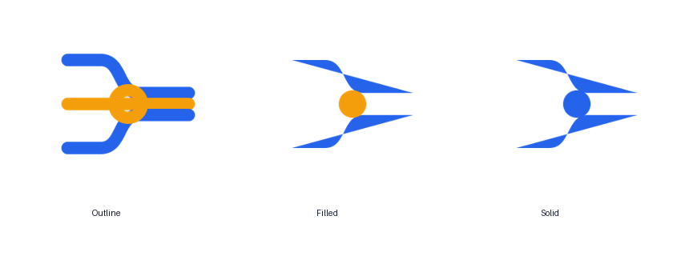

# Frontend Concurrency Lab — Brand and Logo System

> Last verified: 2026-11-14 · baseline `19640ebd8169ce625b2a093caafc1ca2483b6a84` plus the inspected working tree. Confidence: high for asset/source inventory; usage constraints preserve brand intent, not measured rendered legibility. Stale-sensitive sources: [root assets](../brand/), [blueprint copies](./brand/), [public assets](../apps/lab/public/), [HTML metadata](../apps/lab/index.html), [LabHeader](../apps/lab/src/components/LabHeader.vue).

## Concept

The mark is a minimal abstract interpretation of converging/concurrent paths rather than a literal illustration. The preserved assets use a 64-unit mark grid, rounded outline geometry, and two-color logic. The original portfolio-family intent remains brand guidance; it does not impose an application font or layout system.

- Fixed primary asset color: `#2563EB`.
- Fixed accent asset color: `#F59E0B`.
- Lockup text / manifest dark background: `#0F172A`.
- Light application background: `#F8FAFC`; light panels use white.

The UI maps these ideas into Vuetify roles and uses brighter primary/status colors in dark mode. Assets contain literal fills/strokes, not `--color-*` variables. See [design tokens](./03-design-tokens.md) for the current theme API.

## Asset inventory

Root [`brand/`](../brand/) contains the repository-owned set. [`blue-print/brand/`](./brand/) retains blueprint-local copies for relative documentation references. The production public directory contains the served favicon and five scenario illustrations; the full favicon bundle is not automatically published.

| Asset in each brand set | Intended use / implementation status |
| --- | --- |
| `logo-outline.svg` | Architecture diagrams and low-density documentation; blue/amber strokes. |
| `logo-filled.svg` | Documentation/product-card mark; blue/amber filled paths. |
| `logo-solid.svg` | Single-color blue mark for small marks, stamps and badges. |
| `logo-lockup.svg` | Documentation/repository header; SVG text specifies `Inter, ui-sans-serif, system-ui, sans-serif` without embedding the font. |
| `logo-preview.png` | Documentation preview above. |
| `favicons/favicon.svg` | White glyph on blue rounded-square background; copied to the app public root. |
| `favicons/favicon-16x16.png`, `favicon-32x32.png`, `favicon-48x48.png` | Retained tab/legacy bitmap sizes. |
| `favicons/favicon-64x64.png`, `favicon-128x128.png`, `favicon-256x256.png` | Larger bitmap variants for tooling and UI contexts. |
| `favicons/apple-touch-icon.png` | Available home-screen artwork; no current HTML touch-icon link. |
| `favicons/android-chrome-192x192.png`, `android-chrome-512x512.png` | Available install artwork; not evidence of a shipped PWA. |
| `favicons/favicon.ico` | Available legacy icon; not linked by current HTML. |
| `favicons/site.webmanifest` | Original standalone/maskable metadata proposal; not linked or served by the app. Its `/favicons/…` paths require deployment review before reuse. |

Current application integration:

- [index.html](../apps/lab/index.html) links `./favicon.svg`, declares theme color `#0f172a`, and uses the title “Frontend Concurrency Lab.”
- [LabHeader](../apps/lab/src/components/LabHeader.vue) builds the favicon URL from Vite `BASE_URL`, displays it at 34×34, and pairs it with “Concurrency Lab.” Text hides at ≤760px; the link retains the accessible name “Scenarios.” The image has empty alt text because the link supplies its name.
- [Catalog](../apps/lab/src/pages/ScenarioCatalogPage.vue) and [scenario shell](../apps/lab/src/components/ScenarioShell.vue) use distinct repository-owned illustrations from [`public/scenarios/`](../apps/lab/public/scenarios/), with descriptive alternative text and authored aspect ratios. These are teaching illustrations, not alternate logos.

## Usage constraints

Preserved brand requirements:

- Minimum intended digital size: 16px for the solid mark, 24px for outline/filled variants. Check actual legibility for the context.
- Clear space: at least one eighth of the mark width.
- Do not rotate, stretch, recolor, add shadows, or place the outline mark on visually noisy media.
- On the brand-colored favicon background, use the supplied white glyph.
- README/documentation use repository-owned assets with relative paths.
- Do not redraw assets during documentation or UI cleanup.

For a future approved brand change, review root and blueprint copies, the served favicon, HTML metadata, and screenshots together. “Regenerate every favicon” is a consistency requirement; no regeneration command or automated asset pipeline is currently established here. A theme-only dark-mode adjustment does not automatically require recoloring the fixed mark.
